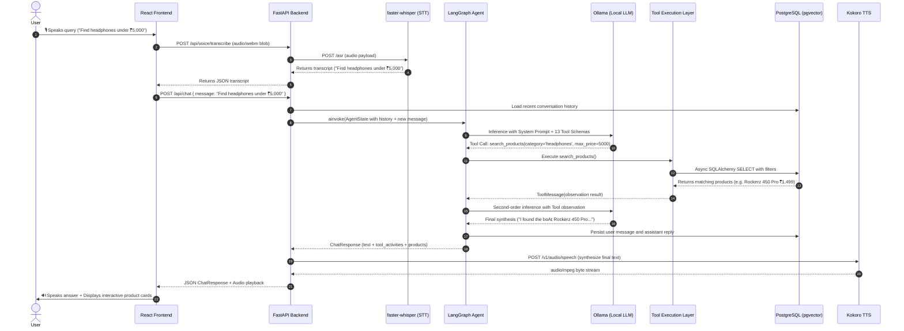
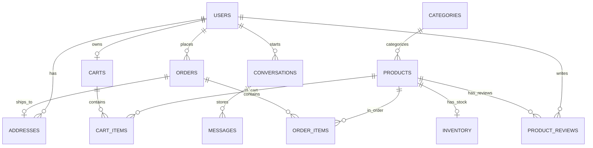

# 🏗️ AgentCart System Architecture

This document provides an in-depth technical overview of the **AgentCart** architecture, data flow patterns, and component interactions.

---

## 1. High-Level System Architecture

AgentCart is structured into four primary layers:
1. **Presentation Layer**: Single Page Application built with React 18 and Vite.
2. **API & Service Gateway**: FastAPI async web framework with dependency injection and Pydantic validation.
3. **Agentic AI & Knowledge Layer**: LangGraph `StateGraph` state machine with native tool-calling, anti-hallucination prompt control, and RAG policy retriever.
4. **Data & Inference Layer**: PostgreSQL 17 with `pgvector`, local Ollama LLM server, `faster-whisper` STT, and `Kokoro TTS`.

```
┌─────────────────────────────────────────────────────────────┐
│                      React 18 Frontend                      │
│   (Catalog UI, Chat UI, Voice Controls, Live Health Dots)   │
└──────────────┬───────────────────────────────▲──────────────┘
               │                               │
               │ HTTP / JSON                   │ Audio Stream / JSON
               ▼                               │
┌──────────────────────────────────────────────┴──────────────┐
│                    FastAPI Backend Gateway                  │
│                                                             │
│  ┌───────────────┐ ┌───────────────┐ ┌───────────────────┐  │
│  │ Products API  │ │   Cart API    │ │    Orders API     │  │
│  └───────┬───────┘ └───────┬───────┘ └─────────┬─────────┘  │
│          │                 │                   │            │
│  ┌───────▼─────────────────▼───────────────────▼─────────┐  │
│  │              Service Layer (Business Logic)           │  │
│  └───────┬───────────────────────────────────────────────┘  │
│          │                                                  │
│  ┌───────▼───────────────────────────────────────────────┐  │
│  │                 LangGraph Agent Layer                 │  │
│  │  - StateGraph ReAct Loop                              │  │
│  │  - 13 Structured Tools (Product, Cart, Order, RAG)    │  │
│  │  - Anti-Hallucination Directives                      │  │
│  └───────┬───────────────────┬───────────────────┬───────┘  │
└──────────┼───────────────────┼───────────────────┼──────────┘
           │                   │                   │
           ▼                   ▼                   ▼
┌──────────────────┐ ┌──────────────────┐ ┌──────────────────┐
│  PostgreSQL 17   │ │   Ollama LLM     │ │  Voice Services  │
│    + pgvector    │ │  (qwen2.5:7b)    │ │ - faster-whisper │
│                  │ │                  │ │ - Kokoro TTS     │
└──────────────────┘ └──────────────────┘ └──────────────────┘
```

---

## 2. End-to-End Multimodal Sequence Diagram

The diagram below details the execution flow when a user speaks a voice command:



---

## 3. Database Entity Relationship Model



---

## 4. State Management in LangGraph

The agent's state is modeled with the `AgentState` TypedDict:

```python
class AgentState(TypedDict):
    messages: Annotated[Sequence[BaseMessage], add_messages]
    user_id: int
    conversation_id: Optional[int]
    tool_activities: List[Dict[str, Any]]
    extracted_products: List[Dict[str, Any]]
```

- **`add_messages` reducer**: Appends messages in chronological order, allowing tool responses (`ToolMessage`) to feed seamlessly back into the reasoning loop without overwriting conversational history.
- **`tools_condition` router**: Evaluates whether the LLM's response contains tool calls. If so, it routes execution to `ToolNode`; if not, it transitions to `END`.
