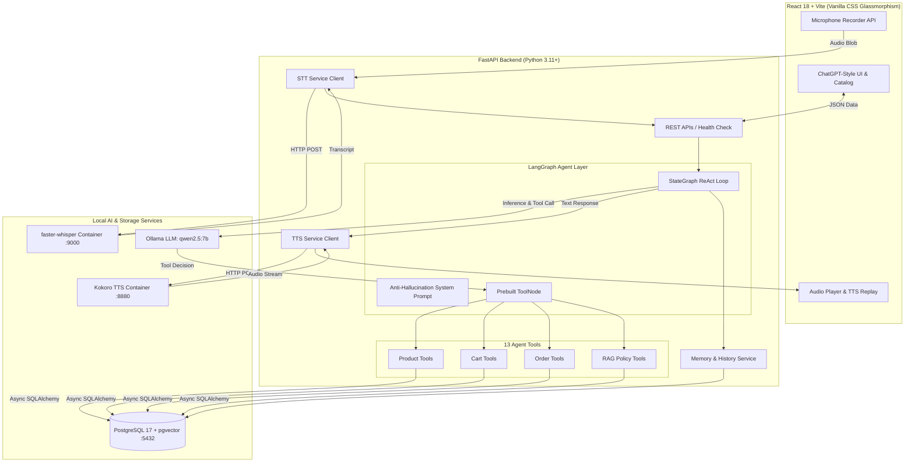

# ⚡ Shoppy Agent — Multimodal Agentic AI E-Commerce Shopping Assistant

[](https://fastapi.tiangolo.com)
[](https://reactjs.org/)
[](https://langchain-ai.github.io/langgraph/)
[](https://ollama.com)
[](https://www.postgresql.org/)
[](https://github.com/SYSTRAN/faster-whisper)
[](https://github.com/hexgrad/kokoro)
[](https://www.docker.com/)

> **Shoppy Agent** (AgentCart) is a full-stack, multimodal e-commerce shopping platform powered by an **autonomous LangGraph agent** running on local LLMs via **Ollama**, featuring voice I/O (**faster-whisper STT** & **Kokoro TTS**), RAG policy retrieval (**pgvector**), conversational memory, and simulated checkout — **100% self-hosted with zero paid API keys required**.

---

## 📑 Table of Contents
1. [Why this is Agentic AI](#-why-this-is-agentic-ai)
2. [Key Capabilities](#-key-capabilities)
3. [System Architecture](#-system-architecture)
4. [Tech Stack](#-tech-stack)
5. [Database Schema](#-database-schema)
6. [Required Agent Tools](#-required-agent-tools)
7. [Quickstart Guide](#-quickstart-guide)
   - [Mode 1: Simple Local Development](#mode-1-simple-local-development-recommended)
   - [Mode 2: Full 6-Service Docker Stack](#mode-2-full-6-service-docker-stack)
8. [Ollama & Voice Model Setup](#-ollama--voice-model-setup)
9. [API Endpoints](#-api-endpoints)
10. [Example Conversational Workflows](#-example-conversational-workflows)
11. [Testing & Evaluation Benchmark](#-testing--evaluation-benchmark)

---

## 🤖 Why this is Agentic AI

Shoppy Agent is **not a simple chatbot** or text generator. It is an **autonomous agentic system** built using a ReAct (Reason + Act) loop via LangGraph:


```
[User Speech / Text Input]
            │
            ▼
   [Reasoning Engine] ─── Evaluates intent & decides required action
            │
            ├── No tool needed ─────────────► [Direct Conversational Response]
            │
            └── Tool needed
                    │
                    ▼
          [Tool Selection & Call] ──── Emits structured JSON schema
                    │
                    ▼
          [Python Execution Layer] ─── Validates parameters & runs SQLAlchemy query
                    │
                    ▼
            [PostgreSQL DB] ────────── Performs search / cart update / order
                    │
                    ▼
             [Observation] ─────────── Raw factual data returned to Agent
                    │
                    ▼
        [Second-Order Reasoning] ───── Agent inspects observation, continues or answers
                    │
                    ▼
       [Synthesis & Voice Output] ──── Streams concise response + Kokoro TTS audio
```

### Anti-Hallucination Directives
- **Zero Hallucinated Products/Prices**: Products, prices, ratings, and technical specifications are strictly retrieved through SQL via tools.
- **Zero Hallucinated Stock**: The agent checks real-time inventory before confirming availability or adding to cart.
- **Zero Hallucinated Orders/Cart**: Orders and cart changes occur strictly through transaction tools, never through LLM text generation.

---

## ✨ Key Capabilities

1. **🎙️ Multimodal Voice I/O**:
   - **Voice Input (STT)**: Direct microphone recording transcribed in real time via local `faster-whisper`.
   - **Voice Output (TTS)**: Natural synthesized speech responses generated by local `Kokoro TTS`.
   - **Voice Toggle**: Automatic spoken replies switchable ON/OFF with live state indicators (`LISTENING`, `TRANSCRIBING`, `THINKING`, `SPEAKING`).
2. **🛍️ Product Discovery & Specs Comparison**:
   - Multi-attribute search (categories, price constraints in ₹ INR, brand, minimum rating).
   - Side-by-side specification comparison tables (refresh rate, battery life, weight, processors).
3. **🛒 Cart & Simulated Order Management**:
   - Add, inspect, adjust quantity, and clear cart items.
   - 1-click simulated order placement with automated inventory reduction and tracking generation.
4. **📚 Store Policy RAG (Retrieval-Augmented Generation)**:
   - Queries policy documents (returns, refunds, warranty, delivery times, cancellations) using vector embeddings and keyword search.
5. **🧠 Conversational Memory**:
   - Full message history and user context persisted across sessions in PostgreSQL.

---

## 🏗️ System Architecture



---

## 🛠️ Tech Stack

| Layer | Component | Description |
|---|---|---|
| **Frontend** | React 18 + Vite | Modern UI, responsive CSS design tokens, glassmorphism, zero Tailwind dependency |
| **Backend** | FastAPI + Uvicorn | Async Python 3.11+, Pydantic validation, dependency injection |
| **Database** | PostgreSQL 17 + pgvector | Async SQLAlchemy ORM, pgvector for semantic embeddings, Alembic migrations |
| **Agent Framework** | LangGraph | StateGraph with ToolNode, tools_condition routing, and chat state persistence |
| **LLM Engine** | Ollama (`qwen2.5:7b`) | Local native function/tool-calling model (configurable via `.env`) |
| **Voice STT** | faster-whisper | Self-hosted speech-to-text service (`onerahmet/openai-whisper-asr-webservice`) |
| **Voice TTS** | Kokoro-FastAPI | Self-hosted text-to-speech audio synthesis (`ghcr.io/remsky/kokoro-fastapi-cpu`) |
| **DevOps** | Docker Compose | Multi-container orchestration with persistent caching and volume mounts |

---

## 🗄️ Database Schema

The system initializes 13 relational tables in PostgreSQL:

| Table | Purpose |
|---|---|
| `users` | Customer profiles (Demo User ID: 1) |
| `categories` | 7 core tech categories (Laptops, Smartphones, Headphones, Monitors, Keyboards, Mice, Smartwatches) |
| `products` | 42+ seeded tech items with JSON specifications, brand, price in ₹, warranty |
| `inventory` | Real-time stock counts per product |
| `carts` | User shopping carts |
| `cart_items` | Unique item entries with quantities and product references |
| `orders` | Simulated orders with status (`confirmed`, `processing`, `shipped`, `delivered`, `cancelled`) |
| `order_items` | Snapshot of purchased products, unit prices, and quantities |
| `addresses` | Customer shipping destinations with default flags |
| `conversations` | Persistent chat sessions |
| `messages` | Chat message records (`user`, `assistant`, `tool`) with JSON metadata |
| `documents` | Store policies & FAQs with 768-dim vector embeddings |
| `product_reviews` | Customer ratings & feedback |

---

## 🧰 Required Agent Tools

The LangGraph agent is armed with 13 structured tools:

### Product Tools
1. `search_products(query, category, min_price, max_price, brand, min_rating, limit)`
2. `get_product_details(product_id)`
3. `compare_products(product_ids)`
4. `check_stock(product_id, quantity)`

### Cart Tools
5. `get_cart(user_id)`
6. `add_to_cart(product_id, quantity, user_id)`
7. `remove_from_cart(product_id, user_id)`
8. `update_cart_quantity(product_id, quantity, user_id)`
9. `clear_cart(user_id)`

### Order Tools
10. `create_order(user_id, shipping_address_id)` *(simulated checkout)*
11. `get_order_status(order_id, user_id)`
12. `get_order_history(user_id)`

### Policy RAG Tool
13. `search_policies(query)` *(semantic & keyword knowledge search)*

---

## 🚀 Quickstart Guide

### Prerequisites
- [Docker & Docker Compose](https://www.docker.com/)
- [Ollama](https://ollama.com/) installed locally
- Node.js 18+ (for frontend dev) & Python 3.11+ (for backend dev)

---

### 1. Clone Repository & Setup Environment
```bash
git clone https://github.com/vasantha-kumar-s/shoppy-agent.git
cd shoppy-agent

# Create environment configuration file from template
cp .env.example .env
```

---

### Mode 1: Simple Local Development (Recommended)

#### 1. Start PostgreSQL with pgvector
```bash
docker compose up -d postgres
```

#### 2. Pull the Ollama Tool-Calling Model
```bash
ollama run qwen2.5:7b
```

#### 3. Setup and Run Backend
```bash
cd backend
python -m venv venv

# Windows PowerShell:
.\venv\Scripts\Activate.ps1
# Linux/macOS:
source venv/bin/activate

pip install -r requirements.txt
python -m seed.seed_data
uvicorn app.main:app --host 0.0.0.0 --port 8000 --reload
```

#### 4. Setup and Run Frontend
```bash
cd frontend
npm install
npm run dev
```
Open **http://localhost:5173** in your browser!

---

### Mode 2: Full 6-Service Docker Stack

To start all 6 services (PostgreSQL, Ollama, Whisper, Kokoro, Backend, Frontend) in a single command:

```bash
docker compose up -d
```
Then pull the model inside Ollama container:
```bash
docker exec -it agentcart-ollama ollama pull qwen2.5:7b
```
Access the application at **http://localhost**!

---

## 🎙️ Ollama & Voice Model Setup

### Ollama Model Recommendations
| Available VRAM | Recommended Model | Command |
|---|---|---|
| **6 GB – 8 GB** (Consumer GPU / M-Series Mac) | `qwen2.5:7b` *(Default)* | `ollama pull qwen2.5:7b` |
| **12 GB – 16 GB** | `qwen2.5:14b` | `ollama pull qwen2.5:14b` |
| **24 GB+** | `qwen2.5:32b` or `llama3.3:70b` | `ollama pull qwen2.5:32b` |

Change the active model anytime in `.env`:
```env
OLLAMA_MODEL=qwen2.5:7b
```

### Voice Services Setup
- **Whisper STT**: Automatically runs on port `9000`. Default model is `base` (configured via `WHISPER_MODEL=base`).
- **Kokoro TTS**: Runs on port `8880`. Default voice is `af_heart` (configured via `KOKORO_VOICE=af_heart`).

---

## 📡 API Endpoints

| Method | Endpoint | Description |
|---|---|---|
| `GET` | `/api/health` | Multi-service health report (DB, Ollama, STT, TTS) |
| `GET` | `/api/products` | Search & filter product catalog |
| `GET` | `/api/products/{id}` | Get complete product specifications |
| `POST` | `/api/products/compare` | Compare multiple products |
| `GET` | `/api/products/{id}/stock`| Check real-time inventory count |
| `GET` | `/api/cart` | View current user shopping cart |
| `POST` | `/api/cart/items` | Add product to cart |
| `PUT` | `/api/cart/items/{id}` | Update quantity of cart item |
| `DELETE` | `/api/cart/items/{id}` | Remove product from cart |
| `DELETE` | `/api/cart` | Clear entire shopping cart |
| `POST` | `/api/orders` | Create simulated checkout order |
| `GET` | `/api/orders` | List customer order history |
| `GET` | `/api/orders/{id}` | Get tracking status of specific order |
| `POST` | `/api/chat` | Send user message to LangGraph agent |
| `GET` | `/api/conversations` | List saved conversation sessions |
| `POST` | `/api/voice/transcribe` | Upload voice audio and receive STT transcript |
| `POST` | `/api/voice/speak` | Synthesize speech audio from text using Kokoro |

---

## 💬 Example Conversational Workflows

### 1. Specification Search & Multi-Step Comparison
> **User**: *"I need a laptop for Python programming under ₹70,000."*  
> **Agent** ⚙️ `search_products(category='laptops', max_price=70000)`  
> **Agent**: *"Here are 3 great options: ProBook Ultra 14 (₹64,999), IdeaPad Flex 5 (₹49,999), and TUF Gaming A15 (₹69,999)..."*  
> 
> **User**: *"Compare the ProBook Ultra 14 and TUF Gaming A15."*  
> **Agent** ⚙️ `compare_products(product_ids=[1, 7])`  
> **Agent**: *"Here is how they compare: The ProBook Ultra 14 weighs 1.4kg with a 2.8K OLED display (ideal for productivity), while the TUF Gaming A15 has an RTX 4050 GPU and 90Wh battery (ideal for heavy computing and gaming)..."*

### 2. Inventory Check, Cart Addition & Simulated Checkout
> **User**: *"Add the ProBook Ultra 14 to my cart."*  
> **Agent** ⚙️ `add_to_cart(product_id=1, quantity=1)`  
> **Agent**: *"Added ProBook Ultra 14 (x1) to your cart."*  
> 
> **User**: *"Place my order."*  
> **Agent** ⚙️ `create_order(user_id=1)`  
> **Agent**: *"Order **#AC1001** has been placed successfully for ₹64,999! Note: This is a simulated checkout and no real payment was charged."*

### 3. Store Policy RAG Question
> **User**: *"Can I return a laptop after 10 days?"*  
> **Agent** ⚙️ `search_policies(query='laptop return window')`  
> **Agent**: *"According to our policy, electronics such as Laptops, Smartphones, and Monitors have a **7-day return window** from the delivery date. Therefore, a return after 10 days would not be eligible under standard return terms."*

---

## 🧪 Testing & Evaluation Benchmark

### Run the Automated Pytest Suite
```bash
cd backend
pytest -v
```
*Result: 13 passed tests covering services, cart consistency, order creation, and API endpoints.*

### Run the Agent Evaluation Dataset
```bash
cd backend
python tests/agent_eval.py
```
*Includes 25 curated test cases across 8 evaluation categories.*

---

## 📄 License
MIT License. Built for educational and portfolio demonstrations.
